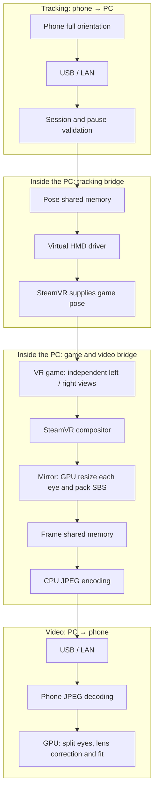
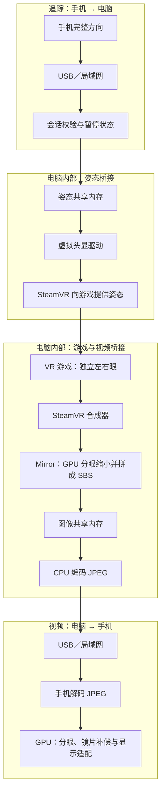

# 🧪 VRization SteamVR experiment / SteamVR 实验版

[English](#english) · [简体中文](#简体中文)

<!-- vrization:english -->
## English

This separate SteamVR experiment is based on released v0.4.0 and was first published as **0.5.0-steamvr-preview**. Keep ordinary VRization and all historical downloads. Its three entries connect different frame/input paths; they are not additional direct-phone display modes. English is the default, with selectable Simplified Chinese. A later authorized Huawei session observed real USB/GLES behavior and part of the Phone HMD chain using an unpublished host candidate. Physical-axis, optics, VR-game, PCVR, long-duration stability, display-FPS and end-to-end-latency acceptance remains incomplete; see [the bounded evidence](docs/VALIDATION.md).

Current unpublished source versions are **Windows 0.5.1-steamvr-preview, Android 0.5.1-steamvr-preview/build 2 and iOS 0.5.1/build 2**. Ordinary VRization remains **0.4.0/build 8**; historical 0.5.0 preview downloads stay preserved. Windows and Android CI passed on code freeze `ad092b0`; iOS CI, final release packaging and real-phone reboot/live-Refresh acceptance remain pending. Earlier candidate evidence is preserved separately.

| Entry | What it does | What to use |
| --- | --- | --- |
| 📱 Original direct phone | Captures a desktop/display region; retains Full screen, Big screen, First person and Enhanced first person. First-person gyro can control the Windows mouse under the existing local input policy. | Preview Windows host + separate preview phone app; original apps remain available separately |
| 🥽 Phone as SteamVR HMD | Full phone orientation drives a virtual 3DOF HMD; the compositor supplies independent left/right images. This route never moves the Windows mouse. | SteamVR installed separately, explicit registration of this preview's driver, and preview Android/iOS client |
| 🎮 Existing SteamVR headset | Adds a desktop screen overlay 3 m wide, 2 m ahead of an already connected native headset. SteamVR games continue using that headset and its existing controllers/tracking. | Existing PCVR or standalone-to-PC SteamVR transport; no phone app required |

A standalone headset must already connect to SteamVR through a compatible transport. This preview does not supply an Android standalone OpenXR app, tracked controllers or a replacement vendor driver. It does not overwrite DPVR, remove other drivers, or edit `forceDriver` or global SteamVR configuration. Phone virtual-HMD/debug-display initialization was observed on the tested PC; reliable restored viewing across idle/active transitions and switching between virtual/physical HMDs remain hardware acceptance items. A SteamVR restart may be needed.

### 🔗 How the three paths work

**Direct phone:** The PC captures a desktop or selected region, prefers GPU crop/rotation/downscaling, reads the smaller pixels back and encodes JPEG on the CPU. USB or LAN carries that image to the phone, which decodes it and renders it with Android GLES or iOS Metal. Both eyes sample the **same desktop image**. First-person modes add a separate phone-orientation → PC mouse path; neither duplicating the image nor the Enhanced mode's wide-angle deformation creates independent game viewpoints or stereoscopic depth.

**Phone as SteamVR HMD:** This route sends direction toward the game and returns the game's independent eye images. The phone sends its full normalized XYZW quaternion. The host checks the accepted session and tracking/pause state before publishing orientation for its virtual HMD driver; SteamVR then makes that orientation available to the VR game. The game renders separate left/right views, and the Mirror helper obtains both compositor eye textures. It scales each eye on the GPU before packing them side by side (SBS), then the host encodes the returned pixels as JPEG for the phone.



Both shared-memory blocks are **inside the PC**, connecting its host and native processes; they are not the phone connection. This HMD route never injects mouse movement. Tracking is **3DOF rotation with a fixed position at 1.6 m height**, without tracked translation or controllers. Phone scale, movement and eye spacing are applied at the final viewing stage, after separating the source eyes; they do not manufacture new viewpoints. GPU scaling still crosses a pixel readback, CPU JPEG encoding, phone decoding and texture upload, so this is **not an all-GPU zero-copy video chain**. A physical Huawei with an unpublished host candidate received real SteamVR background/grid SBS after HMD activation and native Mirror eye acquisition; real sensor packets also reached the pose map. This is partial chain evidence, not a VR-game or complete physical-tracking pass. Phone optics and PCVR acceptance remain pending.

**Existing PCVR or connected standalone headset:** Its original tracking/game path remains **headset tracking → existing SteamVR-compatible transport/driver → SteamVR → VR game → compositor → the original headset display/transport**. Existing controllers and position tracking belong to that setup. VRization adds only its desktop Overlay alongside the game; it does not replace the headset driver, tracking, controllers or game renderer.

The current desktop Overlay path is **desktop capture/downscaling → CPU JPEG encoding → CPU JPEG decoding back to BGRA → PC frame shared memory → native D3D11 texture upload → SteamVR Overlay → headset**. That extra JPEG round trip exists because the preview reuses the desktop capture interface; it must not be described as a direct shared GPU texture path. The overlay is a flat, head-relative screen, 3 m wide and 2 m ahead. Stop or stale data hides and clears it. The original headset's main game path continues independently, and physical headset validation is still pending.

### 📦 Separate installation and connection

Extract the complete experimental Windows package and run its launcher. Keep that folder in place after manually registering its driver. The ordinary `Start-Windows.bat` and stable app install are independent; this experiment does not refresh stable `latest`.

The launcher provides **Register Phone HMD**, **Remove this driver** and **Open SteamVR** as explicit user actions. Registration calls the installed runtime's `vrpathreg adddriver` for only this package's driver directory; removal uses `removedriver` for that same directory. Opening the launcher or its diagnostics performs none of these actions and starts no capture. Do not register or launch a runtime during unattended source/fixture checks.

USB remains the first connection preference, with explicit LAN support. Preview endpoints are isolated:

| Component | Preview identity / endpoints |
| --- | --- |
| Windows | `%LOCALAPPDATA%/VRizationSteamVR/Windows`; each route has a separate child preference directory |
| HTTP/WebSocket host | TCP 8766; ordinary host retains 8765 |
| Android | `org.vrization.steamvr`, source version `0.5.1-steamvr-preview` / build 2; preferences `vrization_steamvr`; USB control 18774, video/bootstrap 18775 |
| iOS | `org.vrization.ios.steamvr`, source version 0.5.1 / build 2; preference key `steamvrPhonePreferencesV1`; USB video 18776, control 18777 |

Use the matching preview app for preview USB endpoints. Preview clients can retain the legacy mono/mouse protocol when no stereo session is negotiated; this never silently turns a direct-phone session into a virtual HMD. Android APK builds are separate install identities. iOS source and Simulator output are not a signed, directly installable iPhone app; physical installation requires the user's Apple signing setup.

For the phone HMD route, explicitly register its driver, start SteamVR, choose the phone entry and start streaming, then connect the preview phone. The host waits for the phone's `stereo-sbs` and `hmd-orientation` capabilities and a complete accepted session snapshot before sending stereo frames. An old client that cannot handle this pairing is rejected with an explanation instead of receiving stereo it cannot render.

### 🎛️ Fit, tracking and Stop

SBS uses each eye's half of the source image and its own aspect ratio. Fit scale, movement, mirrored eye spacing, corner editing, Save/Discard and synchronized local settings remain usable. SteamVR already owns perspective: Cinema and Enhanced square/fisheye projection are bypassed for SBS rendering while the user's saved direct-phone mode is retained. The phone applies its lens correction once; eye UV clamps prevent sampling across the center seam.

The unpublished Windows patch provides Phone HMD profiles independently from direct-phone capture. **Total stereo width** means the combined SBS image: 1280 gives 640 pixels per eye. New users and Reset select Balanced; saved capture choices, including earlier 640/Q45 settings, are not migrated. Custom width/FPS/quality combinations remain Custom; Reset preserves the shared tracking pause.

| Phone HMD profile | Total SBS width | Target FPS | JPEG quality |
| --- | --- | --- | --- |
| Balanced: new-user/Reset default | 1280 | 60 | Q75 |
| Sharper | 1920 | 60 | Q80 |
| Low latency | 640 | 60 | Q45 |

A physical Huawei showed UI decoded-receive **58.0 FPS /8 ms RTT /21.2 ms mean reception-to-texture processing** at 1280/Q75/60, and **58.6–58.7 FPS /21 ms RTT /24.5 ms mean processing** at 1920/Q80/60. Only SteamVR background/grid imagery was tested. At 1920×960/Q80/60, a separate **14.9744952-second** map sample counted **481 Mirror publications**, or **32.121283 publication FPS**. The phone's higher counter includes repeated delivery of captured frames. Publication count, decoded reception, pixel changes and actual display presentation are different measurements; none establishes motion-to-photon latency. Coherent publication-sequence deduplication preserves different frames sharing the same coarse tick. Owned QPC/high-resolution waitable-timer pacing is implemented in source, awaiting exact native CI and fresh physical measurements; no improvement result is claimed yet; [full evidence](docs/VALIDATION.md) records the scopes.

The phone sends full normalized XYZW orientation, not a quaternion reconstructed from Euler mouse angles. This is **3DOF rotation only**, with fixed 1.6 m height and no tracked translation/controllers. No sensor or invalid/stale data produces unavailable tracking, not a fabricated valid identity pose.

**F8, opening the fit editor, Stop and disconnect invalidate HMD tracking.** F8/editor/Stop emergency pause stays latched through reconnect, mode change and Save/Discard. Recenter changes the baseline but does not release that latch. Only **Resume HMD tracking on the PC** releases it, after local conditions allow it. Tracking enabled/paused state is separate from persistent display settings and from the ordinary mouse-control route.

The unpublished host fix refreshes only **invalid tracking status** while an accepted phone session remains connected but tracking is paused or unavailable. It does not replay an old valid quaternion, advance the phone's sequence/time or clear the pause latch. During more than six seconds of physical fit editing with sensors stopped, Mirror stayed alive and its frame sequence advanced; Save retained pause and local PC Resume restored valid pose flags. The phone first stayed gray while still, then physical movement restored viewing; the user reported normal recentering. The paused header no longer caused a native-helper exit in the checked interval. Resume alone while static, complete physical-axis accuracy and long-duration stability remain unverified.

Stop closes the current host session and owned native helper, clears old frames and invalidates pose data. Helpers observe a unique host Stop event and clean up their own resources; a bounded termination fallback exists for a stuck child. The existing-headset overlay hides/clears on inactive or stale frames and destroys only its own overlay. It does not shut down SteamVR or another app.

**Refresh keeps a live Phone HMD session connected while rebuilding video.** The host source replaces Mirror on its capture worker, retaining orientation, session epoch, recenter baseline, settings and fit; it does not pause, Resume, Recenter or resend settings. Phone requests require the negotiated `video-refresh` capability, and video remains gated until the worker has closed the old source and confirmed the matching request. Existing F8/editor/Stop pauses remain latched; use PC-local Resume if already paused. Without a live compatible session, or after the phone's eight-second deadline, Refresh falls back to a complete reconnect under the existing Stop/pause policy. PC full-reconnect cleanup finishes before restart; Stop cancels restart while cleanup continues. Host live-refresh checks passed **15 software tests plus 32 subtests**; phone source integration is complete; remaining iOS CI, final packaging and real-phone recovery are pending.

**Open fault:** The user identified the black PC window as SteamVR's **Headset Window**. Its cause remains under diagnosis; a separate observed exited Mirror explains a connected phone waiting for video in one interval, but does not establish the cause of every black Headset Window. No complete recovery or achieved unique/display FPS is claimed.

### 🛠️ Build, attribution and next test

Native Windows targets are built on a Windows x64 MSVC runner:

At publication, the four native targets and 365 runtime-independent fixture checks passed in [CI 38093072466](https://github.com/LexZeon/VRization/actions/runs/38093072466/job/114333306286), source `550f845f5b551f2c52c36491e3d0c37f313b0ff9`; its complete native bundle was independently audited against exact SDK/asset hashes. An earlier build of identical native source also passed a local software-WARP replay. Local Windows/Python 387 cases plus 312 subtests, 40 script cases and Android 176 cases passed; iOS preview passed both SDK builds, 95+21 Swift cases, two UI cases and 50 pixel samples. The complete Windows ZIP's isolated startup/owned IPC passed and now runs in future preview CI. Later USB-policy and invalid-status-heartbeat regressions passed **416 Windows/Python cases plus 314 subtests**; these software/loopback results have a separate scope from physical observations. See [verification and limits](docs/VALIDATION.md) and the [illustrated connection tutorial](docs/TUTORIAL.md).

```powershell
python scripts/build_steamvr_native.py --configuration Release --test
python -m unittest discover -s scripts -p test_build_steamvr_native.py -v
python scripts/check_docs.py
```

Android preview tasks are `:steamvr-app:assembleSteamvrDebug`, `:steamvr-app:testSteamvrDebugUnitTest` and `:steamvr-app:lintSteamvrDebug`; instrumentation is compiled separately. Follow-up Huawei instrumentation actually passed the recorded GLES mask/enhanced/stereo, lifecycle and synthetic orientation fixtures; synthetic orientation goldens are not physical-axis tests. The separate iOS Xcode project is `ios/VRizationSteamVR.xcodeproj`, with its reusable Swift package in `ios/SteamVR`; physical iPhone testing remains pending. Native fixtures use Windows mappings, Stop events, software WARP pixels and the driver factory ABI without registering a driver or starting SteamVR. Simulator/software fixtures establish only their stated scope.

Valve OpenVR v2.15.6 is pinned to commit `0924064316de3effbcd1acf1e309182a2deb1c05`, with five exact SHA256 files and its original **BSD-3-Clause** license. VRization's IPC, tracking gate, frame packing and overlay implementation are original MIT code; official HMD/overlay lifecycle ideas are credited even without copying sample code. See [native provenance](native/licenses/README.md), [architecture](docs/ARCHITECTURE.md) and [AI handoff](docs/AI_HANDOFF.md).

Remaining hardware work must extend the observed USB Phone HMD chain to repeated cold launch/connect/Stop/reconnect without cable replug, idle/active viewing, physical yaw/pitch/roll and recenter across phone orientations, both-eye source isolation and optics, a real VR game, virtual/native-HMD switching and existing-headset overlay cleanup. F8/editor/Save/Discard must retain their local Resume boundary. Measure FPS/round-trip separately from physical motion-to-photon latency and preserve the existing DPVR setup throughout.

---

<!-- vrization:chinese -->
## 简体中文

这是基于已发布 v0.4.0 的独立 SteamVR 实验版，首个公开版本为 **0.5.0-steamvr-preview**，保留普通 VRization 及全部历史下载。三个入口分别连接不同的画面／输入通路，不是新增直连手机显示模式。软件默认英文，可选择简体中文。后来获授权的华为真机会话已观察真实 USB／GLES 行为，并使用未发布的电脑端候选版走通部分手机头显链路。物理坐标、光学、VR 游戏、PCVR、长期稳定性、显示帧率和端到端延迟尚未完整验收，见[有限范围证据](docs/VALIDATION.md)。

当前未发布源码版本为 **Windows 0.5.1-steamvr-preview、Android 0.5.1-steamvr-preview/build 2、iOS 0.5.1/build 2**。普通版保持 **0.4.0/build 8**，历史 0.5.0 实验版下载原样保留；源码冻结 `ad092b0` 的 Windows 和 Android CI 已通过，iOS CI、最终发布打包及手机重启／活动刷新真机验收仍待完成；此前候选版证据单独保留。

| 入口 | 功能 | 使用条件 |
| --- | --- | --- |
| 📱 原版手机直连 | 采集桌面／选区，保留全屏、大屏幕、第一人称、加强第一人称。第一人称陀螺仪按既有本地输入规则控制 Windows 鼠标。 | 实验版电脑端和独立实验版手机端；原版应用另外保留 |
| 🥽 手机作为 SteamVR 头显 | 手机完整方向驱动虚拟三自由度头显，合成器提供独立左右眼图像；此路线不移动 Windows 鼠标。 | 另装 SteamVR、显式注册本实验版驱动、实验版 Android／iOS 手机端 |
| 🎮 现有 SteamVR 头显 | 在已连接实体头显前方 2 米添加宽 3 米的桌面覆盖层；SteamVR 游戏仍使用原有头显、控制器和追踪。 | 已有 PCVR 或一体机连接电脑的 SteamVR 通路；不需要手机应用 |

一体机必须已通过兼容通路连接 SteamVR。本实验不提供 Android 一体机 OpenXR 应用、追踪控制器或替代厂商驱动，不覆盖 DPVR、不移除其他驱动，也不修改 `forceDriver` 或 SteamVR 全局配置。已在测试电脑观察手机虚拟头显／调试显示初始化；静止／活动切换时可靠恢复观看及虚拟／实体头显切换仍待实机验收，可能需要重启 SteamVR。

### 🔗 三条链路怎样工作

**手机直连：** 电脑采集桌面或选区，优先在 GPU 裁切、旋转和缩小，再回读较小的像素，由 CPU 编码 JPEG。USB 或局域网把图像传到手机，手机解码后用 Android GLES 或 iOS Metal 渲染。双眼采样的是**同一张桌面画面**。第一人称另有“手机方向 → 电脑鼠标”控制链；复制画面和加强模式的广角变形都不会生成独立游戏视角或立体深度。

**手机作为 SteamVR 头显：** 这条路线把方向送往游戏，再把游戏的独立双眼画面传回来。手机发送完整归一化 XYZW 四元数；电脑验证已接受会话及追踪／暂停状态后，将方向交给虚拟头显驱动，SteamVR 再向 VR 游戏提供这个方向。游戏分别渲染左右眼，Mirror 工具取得合成器的两张眼纹理，先在 GPU 分别缩小，再横向拼成 SBS；电脑将回读像素编码为 JPEG，传给手机。



两块共享内存都在**电脑内部**，连接电脑服务与原生进程，不是手机连接方式。这条头显路线不会注入鼠标移动；追踪只有 **3DOF 旋转，位置固定在 1.6 米高度**，没有移动位置追踪或控制器。手机的缩放、移动和眼间距在分离源图双眼之后、最后显示阶段应用，不会制造新视角。GPU 缩小后仍需像素回读、CPU JPEG 编码、手机解码及纹理上传，所以它**不是全 GPU 零拷贝视频链**。华为真机使用未发布电脑端候选版，在头显激活、原生 Mirror 获取双眼后收到真实 SteamVR 背景／网格 SBS；真实传感器消息也到达姿态映射。这只是部分链路证据，不是 VR 游戏或完整物理追踪通过，手机光学及 PCVR 验收仍待完成。

**现有 PCVR 或已连接的一体机：** 原有追踪／游戏主链仍是**头显追踪 → 已有兼容 SteamVR 的连接／驱动 → SteamVR → VR 游戏 → 合成器 → 原有头显显示／传输通路**。控制器及位置追踪由原有设备提供。VRization 只在游戏旁添加桌面 Overlay，不替换头显驱动、追踪、控制器或游戏渲染器。

当前桌面覆盖层实际经过**桌面采集／缩小 → CPU JPEG 编码 → CPU JPEG 解码回 BGRA → 电脑图像共享内存 → 原生 D3D11 纹理上传 → SteamVR Overlay → 头显**。这次额外的 JPEG 往返来自复用桌面采集接口，不能描述成直接共享 GPU 纹理。覆盖层是随头部的平面屏幕，宽 3 米、位于前方 2 米；停止或数据过期时会隐藏并清空。原有头显游戏主链独立继续，实体头显验证仍待完成。

### 📦 独立安装与连接

完整解压实验版 Windows 包，运行其中的启动器；手动注册驱动后保留该目录。普通 `Start-Windows.bat` 和正式应用安装相互独立；本实验不刷新正式 `latest`。

启动器的“注册手机头显”“移除此驱动”“打开 SteamVR”均是用户显式操作。注册只用已安装运行环境的 `vrpathreg adddriver` 添加本包驱动路径，移除只用 `removedriver` 删除同一路径。仅打开启动器或运行诊断不会执行这些动作，也不会开始采集；无人值守源码／测试检查时不要注册或启动运行环境。

USB 仍为优先连接方式，另保留显式局域网；实验版端点独立：

| 组件 | 实验版标识／端点 |
| --- | --- |
| Windows | `%LOCALAPPDATA%/VRizationSteamVR/Windows`；每条路线有独立子设置目录 |
| HTTP／WebSocket 电脑服务 | TCP 8766，原版仍为 8765 |
| Android | `org.vrization.steamvr`、源码版本 `0.5.1-steamvr-preview`／build 2；设置 `vrization_steamvr`；USB 控制 18774，视频／发现 18775 |
| iOS | `org.vrization.ios.steamvr`、源码版本 0.5.1／build 2；设置键 `steamvrPhonePreferencesV1`；USB 视频 18776，控制 18777 |

实验版 USB 端点使用对应实验版应用。未协商双眼会话时，实验版手机可保留旧的 mono／mouse 协议，不会把直连会话悄悄变成虚拟头显。Android APK 使用独立安装标识；iOS 源码／模拟器产物不是已签名、可直接安装的 iPhone 应用，真机安装需要用户的 Apple 签名环境。

手机头显路线需显式注册其驱动、启动 SteamVR、选择手机入口并开始串流，再连接实验版手机。电脑端收到 `stereo-sbs` 和 `hmd-orientation` 能力，发送完整的已接受会话快照后，才发双眼帧。不能处理此组合的旧手机会明确收到拒绝说明，不会收到无法正确渲染的双眼画面。

### 🎛️ 适配、追踪与停止

SBS 为每眼使用各自半幅源图及自身比例，仍可缩放、移动、镜像调整眼间距、拖顶点、保存／弃用并同步本地设置。SteamVR 已决定透视，所以双眼渲染绕过大屏幕和加强正方形／鱼眼投影，但保留用户存储的直连模式。手机镜片补偿只做一次，分眼 UV 边界防止采样穿过中缝。

未发布 Windows 补丁为手机头显提供独立于直连采集的预设。“**双眼总宽度**”是合并的 SBS 宽度：1280 对应每眼 640 像素。新用户及重置选择均衡；已经保存的采集选择，包括旧 640／Q45，不自动迁移。自定义宽度／帧率／质量组合仍标为自定义，重置保留共用的追踪暂停锁。

| 手机头显预设 | SBS 总宽 | 目标 FPS | JPEG 质量 |
| --- | --- | --- | --- |
| 均衡：新用户／重置默认 | 1280 | 60 | Q75 |
| 更清晰 | 1920 | 60 | Q80 |
| 低延迟 | 640 | 60 | Q45 |

华为真机在 1280／Q75／60 下，界面显示解码接收 **58.0 FPS／RTT 8 毫秒／接收到纹理处理平均 21.2 毫秒**；1920／Q80／60 为 **58.6–58.7 FPS／RTT 21 毫秒／平均处理 24.5 毫秒**。仅测试 SteamVR 背景／网格。1920×960／Q80／60 的独立映射采样在 **14.9744952 秒**计得 **481 次 Mirror 发布**，即 **32.121283 发布 FPS**；手机更高的计数包含重复交付采集帧。发布计数、解码接收、像素变化和实际显示呈现是不同测量，都不等于运动到显示延迟。一致性发布序号去重保留粗粒度 tick 相同但序号不同的帧；自有 QPC／高分辨率可等待定时器节奏已在源码实现，仍待准确原生 CI 和新真机测量，尚无已验证提升结果；范围见[完整证据](docs/VALIDATION.md)。

手机发送完整归一化 XYZW 方向，不从鼠标用的欧拉角重建四元数。它只有 **3DOF 旋转**，固定 1.6 米高度，没有位置追踪／控制器。缺传感器或无效／旧数据只产生不可用追踪，不伪造有效恒等姿态。

**F8、打开适配编辑器、停止和断开都会令头显追踪无效。** F8／编辑器／停止的紧急暂停在重连、切模式和保存／弃用后仍锁定；重新居中只改基准，不解除锁定。只有电脑本地条件允许后的“恢复头显追踪”可以解除。追踪启用／暂停状态与持久显示设置、原版鼠标路线相互独立。

未发布电脑端修复在已接受的手机会话仍连接、追踪暂停或不可用时，只刷新**无效追踪状态**，不重放旧有效四元数、不递增手机序号／时间，也不解除暂停锁。停止传感器的真实适配编辑持续超过六秒时，Mirror 仍存活且帧序号推进；保存保留暂停，电脑本地恢复令有效姿态标志重新出现。手机静止时先保持灰色，实际移动后画面恢复，用户报告回正正常。检查区间内，暂停头信息不再导致原生工具退出；尚未验证静止时仅点恢复、完整物理坐标准确性或长期稳定性。

停止会关闭当前电脑会话和自身原生子进程，清除旧帧并令姿态无效。工具检查独立 Stop 事件，清理自己的资源；对子进程卡死保留限时结束后备方式。已有头显覆盖层在数据停用／过期时隐藏、清空，只销毁自己覆盖层，不关闭 SteamVR 或其他应用。

**刷新可保持活动手机头显会话，只重建视频。** 电脑端源码在采集工作线程替换 Mirror，保留方向、会话代际、居中基准、设置和适配；不暂停、不恢复、不居中，也不重发设置。手机请求须协商 `video-refresh` 能力，旧采集源关闭并确认匹配请求之前不重新放行视频。已有 F8／编辑器／停止暂停锁保持，需要时由电脑本地恢复；没有活动兼容会话或手机等待超过八秒时，按原停止／暂停策略退回完整重连。电脑完整重连先清理再重启，停止取消重启而清理继续。电脑端活动刷新通过 **15 项软件测试加 32 个子检查**；手机源码集成已完成，余下 iOS CI、最终打包和真机恢复仍待验收。

**仍在定位的故障：** 用户确认电脑黑色窗口是 SteamVR 的 **Headset Window**。原因仍在诊断；另一次观察到的 Mirror 退出能解释该区间手机已连接却等待视频，但不能据此认定全部 Headset Window 黑屏都只有这个原因。不声称完整恢复或实际不同帧／显示帧率通过。

### 🛠️ 构建、鸣谢及下次测试

原生 Windows 目标在 Windows x64 MSVC runner 构建：

发布时，四个原生目标及 365 项不依赖运行环境的检查在 [CI 38093072466](https://github.com/LexZeon/VRization/actions/runs/38093072466/job/114333306286) 通过，源码 `550f845f5b551f2c52c36491e3d0c37f313b0ff9`；完整原生包另核对 SDK／文件固定哈希，相同源码的较早构建也通过本机软件 WARP 复跑。本机 Windows／Python 387 项加 312 子检查、40 脚本测试、Android 176 项通过；iOS 实验版通过双 SDK、95+21 Swift、2 UI、50 像素采样。完整 Windows ZIP 的独立启动／自有 IPC 通过，并纳入未来实验 CI。后来的 USB 策略和无效状态心跳回归通过 **416 项 Windows／Python 加 314 个子检查**；这些软件／回环结果与真机观察的范围区分。见[验证及范围](docs/VALIDATION.md)和[连接图文教程](docs/TUTORIAL.md)。

```powershell
python scripts/build_steamvr_native.py --configuration Release --test
python -m unittest discover -s scripts -p test_build_steamvr_native.py -v
python scripts/check_docs.py
```

Android 实验版任务为 `:steamvr-app:assembleSteamvrDebug`、`:steamvr-app:testSteamvrDebugUnitTest`、`:steamvr-app:lintSteamvrDebug`；仪器测试另行编译。后续华为真机确实执行并通过所记录的 GLES 遮罩／加强／立体、生命周期及合成方向测试；合成方向标准值不等于物理坐标测试。独立 iOS 工程为 `ios/VRizationSteamVR.xcodeproj`，可复用 Swift 包在 `ios/SteamVR`；实体 iPhone 仍待测试。原生测试使用 Windows 映射、Stop 事件、软件 WARP 像素及驱动工厂 ABI，不注册驱动或启动 SteamVR；模拟器／软件测试只证明其明确覆盖的范围。

Valve OpenVR v2.15.6 锁定 commit `0924064316de3effbcd1acf1e309182a2deb1c05`，五个文件校验准确 SHA256，并保留 **BSD-3-Clause** 原许可。VRization 的 IPC、追踪门控、帧拼接和覆盖层是 MIT 原创代码；即使未复制示例源码，也记录官方头显／覆盖层生命周期思路。参见[原生来源](native/licenses/README.md)、[架构](docs/ARCHITECTURE.md)、[AI 接手](docs/AI_HANDOFF.md)。

剩余硬件工作需将已观察的 USB 手机头显链路扩展到不拔线的重复冷启动／连接／停止／重连、静止／活动观看、不同持机方向的物理 yaw／pitch／roll 与居中、手机分眼源隔离与光学、真实 VR 游戏、虚拟／实体头显切换及已有头显覆盖层清理。F8／编辑／保存／弃用继续保留本地恢复边界。帧率／往返时间与运动到显示的物理延迟分开测量，全程保留既有 DPVR 配置。
