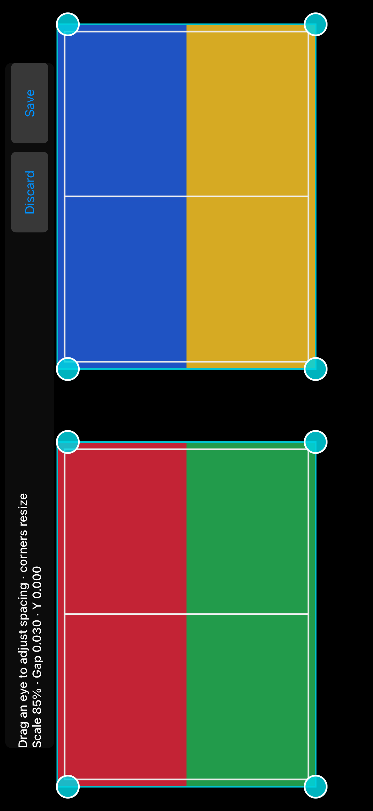

# 🥽 Three ways to connect / 三种连接方式

[English](#english) · [简体中文](#简体中文)

<!-- vrization:english -->
## English

Download the separate [0.5.1 SteamVR preview](https://github.com/LexZeon/VRization/releases/tag/v0.5.1-steamvr-preview), fully extract the Windows ZIP and open `Start-SteamVR-Preview.bat`. Keep its `native`, `drivers` and license files together. Choose English or 简体中文 in the launcher. Keep the ordinary app and historical folders; this preview has independent phone identities, ports and preferences. Install the matching **SteamVR Android APK build 3**. iPhone source/Simulator downloads require a Mac and Apple signing before physical installation.

| Choose | Use it for | First steps |
| --- | --- | --- |
| 📱 Original direct phone | Desktop, a display/region, or ordinary games in the four original viewing modes | Choose the direct-phone entry, connect an authorized USB phone, start streaming on PC or connect on phone. LAN is also available. No SteamVR registration is needed. |
| 🥽 Phone as SteamVR HMD | Experimental SteamVR games viewed through a phone box, with gyro rotation | Register only this package's driver using the launcher, open SteamVR, choose Phone HMD and start/connect the matching app. Explicit Refresh on either end can recover an older enabled HMD pause; PC Resume remains available. |
| 🎮 Existing SteamVR headset | A desktop overlay while using an already connected PCVR/standalone headset | First connect the headset to SteamVR using its existing software. Choose Existing SteamVR headset, select the desktop/display and start the overlay. Native games and controllers keep their original SteamVR path. |

Phone HMD support is **rotation-only 3DOF**, with fixed head position and no simulated tracked controllers. One real Huawei HBP-AL00/API31 received SteamVR background/grid SBS and real sensor tracking. The user accepted both Refresh buttons and a bounded reboot/unlock/another-Refresh sequence; a final fresh-native run retained valid poses across both-end/repeated Refresh and preserved its current preferences. Complete axes, VR games, PCVR, long stability and physical iPhone remain unverified. Static SteamVR Standby may remain gray until real movement. A standalone headset needs its existing compatible PC connection; this preview adds no universal standalone transport. Registration/removal changes only this package's path and keeps other drivers; retain the registered folder's location.

### 🔄 Find Refresh and choose quality

On Windows, use **Refresh / Rebuild connection** in the Phone HMD connection card. On Android/iOS, show settings and use **Refresh** at the top. This explicit enabled-HMD action rebuilds video and may recover an older pause after worker-owned old-video cleanup; repeated requests coalesce. Already-active tracking keeps its baseline. A newer F8/editor pause, disable or Stop during cleanup takes priority; Stop cancels recovery. Ordinary Connect/auto reconnect and Save/Discard do not request recovery.

Phone HMD defaults to Balanced **1280 total stereo width /JPEG Q75 /60 FPS target** for new users and Reset; each source eye gets half that width. Sharper is **1920/Q80/60** and Low latency **640/Q45/60**. Saved choices and direct-phone defaults stay intact. The fit editor changes display placement/size; enlarging the image does not raise its source resolution. A target is not measured display FPS.

### 🎛️ Fit the phone box

Open the first settings item, **Headset fit editor**. Drag either eye to change mirrored spacing; moving the left eye left moves the right eye right. Drag inward until the inner edges touch if needed. Drag a corner to resize proportionally, or move vertically to fit the phone box. **Save** commits and synchronizes the display profile with the connected PC. **Discard** restores the last committed profile. These fit settings also apply to SBS; SteamVR projection is kept while each eye samples only its own source half.

Original iPhone Simulator capture from [CI 38092654893](https://github.com/LexZeon/VRization/actions/runs/38092654893), showing the actual native editor with an original synthetic SBS grid. Red/green and blue/yellow are deliberately different source eyes. This is not a physical iPhone or a SteamVR runtime capture. The screenshot is preserved without pixel edits; SHA256 `4dd40ca9acacaa994e8e6d34f486bd7e78db22e6efb056142cb7e876fe4ee70a`.

The Simulator viewer retains straight SBS borders even with a saved Enhanced first-person profile: SteamVR owns the projection, so the direct-phone square/fisheye step is bypassed. A phone lens correction stage remains available once. The ordinary direct-phone Enhanced mode continues to use its square angular projection.

### ⏹️ Stop and resume

Phone Disconnect and PC Stop close their active session and clear old frames. **F8, the fit editor and Stop latch HMD tracking paused**; ordinary reconnect and Save do not release it. After closing the editor, use either end's **Refresh** to request guarded recovery of an older enabled HMD pause, or use **Resume HMD tracking on PC**. Newer F8/editor/disable/Stop actions still win over an in-flight Refresh. Recenter changes only the baseline. HMD never injects Windows mouse input; direct-phone first-person keeps its local mouse policy. Existing-headset Stop hides/destroys this preview's overlay without closing SteamVR.

For reusable interfaces, handoff guidance and the hardware checklist, see [architecture](ARCHITECTURE.md), [AI handoff](AI_HANDOFF.md), [verification](VALIDATION.md) and [OpenVR credit](../native/licenses/README.md).

---

<!-- vrization:chinese -->
## 简体中文

下载独立 [0.5.1 SteamVR测试版](https://github.com/LexZeon/VRization/releases/tag/v0.5.1-steamvr-preview)，完整解压Windows ZIP，将 `native`、`drivers`及许可文件保持在一起，打开 `Start-SteamVR-Preview.bat`；启动器可选英文或中文。保留普通版及历史目录，实验版使用独立手机身份、端口和偏好。安装对应 **SteamVR Android APK build 3**；iPhone源码／模拟器下载需Mac及Apple签名才能装真机。

| 选择 | 用途 | 起步操作 |
| --- | --- | --- |
| 📱 原版手机直连 | 桌面、显示器／选区、普通游戏，保留原来的四种显示模式 | 选手机直连入口，接入已授权 USB 手机，在电脑开始串流或手机连接；另有局域网。此入口无需注册 SteamVR 驱动。 |
| 🥽 手机作为 SteamVR 头显 | 用手机盒子和陀螺仪旋转尝试 SteamVR 游戏 | 在启动器仅注册本包驱动，打开SteamVR，选手机头显并开始／连接对应应用；任一端显式刷新可恢复已有启用头显暂停，电脑恢复仍可用。 |
| 🎮 已有 SteamVR 头显 | 已连接的 PCVR／一体机中显示桌面覆盖层 | 先用头显已有软件连接 SteamVR，选已有头显入口，选桌面／显示器并启动覆盖层。原生游戏与控制器沿用原 SteamVR 通路。 |

手机头显只有 **3DOF旋转**，头部位置固定，没有模拟追踪控制器。单台实体华为HBP-AL00／API31收到SteamVR背景／网格SBS及真实传感器追踪；用户接受两端刷新及有限重启／解锁／再刷新过程，最终新原生包双端／重复刷新保留有效姿态和当前偏好。完整坐标、VR游戏、PCVR、长期稳定及实体iPhone仍未验收，静止SteamVR待机可能灰屏，实际移动后恢复。一体机需要已有兼容电脑连接方式，本版不增加通用一体机传输；注册／移除只针对本包路径并保留其它驱动，请保持注册文件夹位置。

### 🔄 找到刷新与选择画质

电脑手机头显连接卡使用“刷新／重建连接”；Android／iOS显示设置后在最上方使用“刷新”。该显式已启用头显操作重建视频，在所属工作线程完成旧视频清理后可恢复已有暂停，重复请求会合并；原本活动追踪保持基准。清理期间新F8／编辑暂停、禁用或停止优先，停止取消恢复；普通连接／自动重连及保存／弃用不请求恢复。

手机头显新用户和重置默认均衡 **双眼总宽1280／JPEG Q75／目标60 FPS**，每只源眼获得总宽一半；更清晰 **1920／Q80／60**，低延迟 **640／Q45／60**。保存选择及直连默认保留；适配编辑器改变显示位置／大小，放大不提升源分辨率，目标不等于实测显示FPS。

### 🎛️ 适配手机盒子

打开设置第一项“头显适配编辑器”。拖任一眼调整镜像间距：左眼向左，右眼向右；向内拖时，两眼内侧边缘可接触。拖顶点等比例缩放，或上下移动以适配盒子。“保存”提交显示配置并与已连接电脑同步；“弃用”恢复上次已提交配置。这些显示范围同样用于 SBS，每眼只取对应半幅图像，保留 SteamVR 的投影。

来自 [CI 38092654893](https://github.com/LexZeon/VRization/actions/runs/38092654893) 的原始 iPhone 模拟器截图：真实原生编辑器和原创合成双眼网格，红／绿、蓝／黄刻意表示不同源眼。它不是实体 iPhone 或 SteamVR 运行环境截图。图片像素未经修改，SHA256 `4dd40ca9acacaa994e8e6d34f486bd7e78db22e6efb056142cb7e876fe4ee70a`。

即使保存过加强第一人称配置，模拟器 SBS 查看器边缘仍保持直线：SteamVR 决定投影，因此绕过直连模式的正方形／鱼眼步骤，手机镜片补偿仍可只做一次。普通手机直连的加强模式仍使用正方形角度投影。

### ⏹️ 停止与恢复

手机断开和电脑停止关闭活动会话并清掉旧帧。**F8、适配编辑器、停止锁定头显追踪暂停**，普通重连和保存不解除；关闭编辑器后可在任一端“刷新”请求受保护恢复旧的启用头显暂停，也可用电脑“恢复头显追踪”。处理中新的F8／编辑／禁用／停止仍优先，重新居中只改变基准；头显不注入Windows鼠标，直连第一人称保留本地鼠标规则，已有头显停止会隐藏／销毁本版覆盖层而不关闭SteamVR。

可移植接口、接手说明和真机清单见[架构](ARCHITECTURE.md)、[AI 接手](AI_HANDOFF.md)、[验证](VALIDATION.md)及 [OpenVR 鸣谢](../native/licenses/README.md)。
